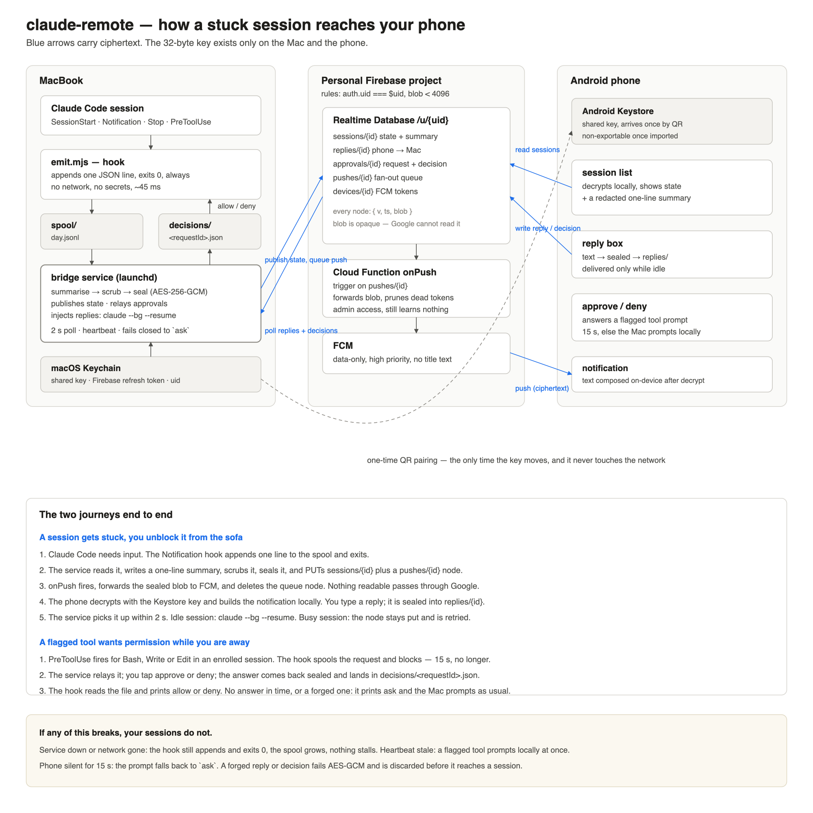

# Push setup (Phase 7)



The Cloud Function forwards an already-encrypted blob to FCM. It has admin
access to the database and still cannot read a single session summary: the key
it would need exists only in the macOS Keychain and the Android Keystore.

## 1. Enable Blaze

Cloud Functions require the pay-as-you-go plan even when usage stays inside the
free tier. In the Firebase console: **⚙ → Usage and billing → Details &
settings → Modify plan → Blaze**.

Set a budget alert in the same flow. Expected cost for one person is zero — the
free tier is 2M invocations a month and this sends a handful a day — but an
alert turns a runaway loop into an email instead of a bill.

## 2. Deploy

```bash
cd functions && npm install
```

```bash
npx firebase deploy --only functions,database
```

`database` ships the rules, which now include the `pushes` path the function
triggers on. Deploy both together: the function cannot fire until the rules
permit the bridge to write that node.

## 3. Register the handset

The Android app writes its own token to `/u/{uid}/devices/{installId}`:

```json
{ "fcmToken": "<token>", "updatedAt": 1763600000000 }
```

Nothing else registers it, and no token ever reaches the Mac. The function
prunes any token FCM reports as dead, so an uninstalled app disappears from the
list on the next push.

## What gets pushed

Only a transition *into* `waiting_input`, `waiting_approval`, `done`, or
`error` (decision D10). Work simply carrying on is not an interruption, and a
session that emits three notifications while waiting still buzzes once.
